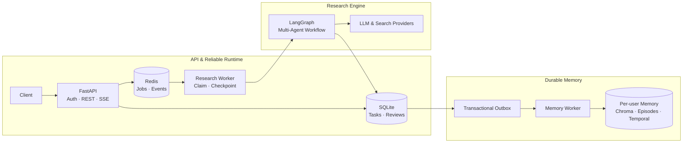
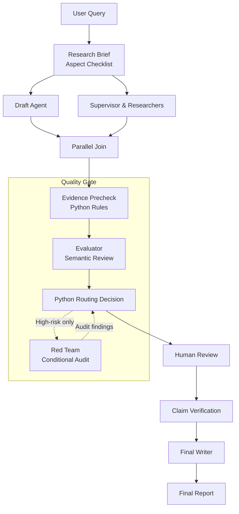

# Deep Research Agent

**一个面向长链路研究任务的可恢复、多 Agent 深度研究系统。**

基于 **LangGraph · FastAPI · Redis · SQLite · Chroma**，将并行研究、证据质量控制、人工审核与长期记忆连接为一条可追踪的执行链路。

> **设计重点：** 研究过程可恢复 · 质量门控可解释 · 记忆按用户隔离 · 评测结果可对照

## 核心设计

| 关注点 | 当前实现 |
| --- | --- |
| **可靠执行** | API 与 Worker 解耦；Redis Streams、任务租约、心跳、超时接管、Checkpoint 恢复 |
| **并行研究** | Research Brief 生成后，Draft 与 Supervisor / Researchers 并行推进 |
| **质量控制** | Python 证据预检 + Evaluator 语义审核 + 条件触发 Red Team + 确定性补研决策 |
| **人工审核** | HITL 审核决定先持久化，再恢复研究图；支持批准、修改草稿、追加研究 |
| **长期记忆** | Memory 3.0：分段报告、结构化 Claim / Evidence、混合检索、阶段召回、Episodic / Temporal Memory |
| **用户隔离** | Bearer Token 身份、任务归属校验、独立 Memory 命名空间以及异步 Outbox 用户上下文 |
| **质量与成本评测** | 检索、研究成功率、证据质量、Memory 消融、延迟与故障恢复 |

## 系统架构



**执行边界：** FastAPI 负责认证、任务命令、状态查询和 SSE；只有独立 Worker 执行 LangGraph。研究完成后，报告持久化与 Memory Outbox 入队由事务协调，Memory Worker 异步整理长期记忆；阶段感知召回为研究 Agent 提供受限的历史上下文。

## 研究流程

以下仅展开**正常主路径**。补研、人工修改等反馈分支放在图下说明，避免回环箭头遮挡研究主线。



**Quality Gate 的职责分工**

| 模块 | 判断重点 |
| --- | --- |
| **Evidence Precheck · Python** | 必查维度、完整来源账本、发布日期、来源去重和最低结构覆盖要求 |
| **Evaluator · LLM** | 论证深度、证据与结论的语义关系、清单之外的重要遗漏 |
| **Red Team · 按需 LLM** | 高风险结论的反例、隐藏假设和重大推理漏洞 |
| **Python Router** | 根据明确问题、补研预算、异常及新增覆盖情况决定下一步动作 |

**反馈分支**

| 触发条件 | 执行动作 |
| --- | --- |
| 预检发现证据缺口且预算允许 | **Targeted Research** → 重新进行 Evidence Precheck |
| Evaluator / Red Team 发现可执行的重大补研主题 | **Targeted Research** → 重新审核 |
| 补研预算耗尽、检查异常或需要人工裁决 | 进入 **Human Review**，展示尚未解决的问题 |
| 人工选择 `revise_draft` | 修改草稿后重新预检，不无故增加搜索 |
| 人工选择 `more_research` | 按反馈定向补研 |
| 人工选择 `approve` | 接纳当前研究代际的 Findings，进入 Claim Verification |

系统使用 `generation` / `seed_fingerprint` 隔离补研前后的候选证据；只有人工批准后才进入权威研究状态。**结构覆盖检查不等于事实已经核实**，研究记忆也不能替代本轮来源核查。

深入了解：[Quality Gate 设计](docs/QUALITY_GATE.md) · [系统架构](architecture/README.md) · [代码地图](architecture/CODE_MAP.md)。

## Memory 3.0 与用户隔离

| 记忆层 | 职责 |
| --- | --- |
| **Report / Section** | 持久化完整报告，按分段进行精确召回 |
| **Structured Semantic** | 保存 Entity、Claim、Evidence、Contradiction 及来源关系 |
| **Hybrid & Stage-aware Retrieval** | 融合 Dense、关键词、实体信号，并按研究阶段限制召回上下文 |
| **Episodic** | 记录查询、来源域名与工具执行轨迹 |
| **Temporal** | 保存事实变化候选及人工审核账本 |
| **Durable Outbox** | 报告落库后异步、可重试地生成记忆，避免延长用户等待链路 |

在多用户模式中，服务端从 Bearer Token 确定可信账户，SQLite 任务记录保存归属；Worker 和 Memory Outbox 根据任务归属选择独立的 Chroma、结构化与 Episodic Memory，Temporal 审核记录按用户过滤。未配置多用户时使用单用户 `local` 空间。

详见 [Memory 架构](architecture/MEMORY.md)。

## 评测结果与消融分析

### 研究质量、检索与运行性能

评测范围包括 **120 道 Chroma 相关性标注查询、30 道研究任务（4 组 Memory 配置）及 40 次故障注入实验**。研究报告通过独立质量审阅；检索、研究与故障恢复分别采用对应的对照口径。

|指标|Baseline|优化后|变化|
|---|---|---|---|
|Chroma Recall@5|84.2%|88.3%|+4.1 pp|
|nDCG@10|0.803|0.831|+0.028|
|Task Completion Rate|93.3%|96.1%|+2.8 pp|
|Reviewed Task Success|77.8%|85.6%|+7.8 pp|
|Mean Aspect Coverage|78.4%|86.5%|+8.1 pp|
|Source Adequacy Pass Rate|85.1%|91.9%|+6.8 pp|
|Unsupported Claim Rate|12.9%|7.9%|-5.0 pp|
|Supported Citation Rate|87.1%|93.7%|+6.6 pp|
|Tool Success Rate|98.5%|98.6%|+0.1 pp|
|Search Calls / Task|12.2|10.4|-14.8%|
|Total Tokens / Task|56,000|49,200|-12.1%|
|Latency P50 / P95|223 / 268s|219 / 273s|P95 +1.9%|
|Context Overflow Count|0|0|无溢出|
|Fault Recovery Rate|—|38/40（95.0%）|独立故障实验|

检索对比：**Dense-only → Hybrid**；Agent 对比：**`memory_off` → `stage_plus_episodic`**。故障恢复为独立实验，不与普通研究完成率混算。

**Paired Reviewed Success Improvement：+7.8 pp；95% CI `[+1.7, +14.4]` pp。**

### Memory 消融

同一 `task_id` 在不同 Memory 配置之间进行配对比较；置信区间按任务维度重采样。

| Memory Variant          | Completion | Reviewed Success | Δ vs Baseline | Paired 95% CI    |
| ----------------------- | ---------- | ---------------- | ------------- | ---------------- |
| `memory_off`            | 93.3%      | 77.8%            | —             | —                |
| `report_section_memory` | 94.4%      | 81.1%            | +3.3 pp       | [-1.7, +8.3] pp  |
| `stage_recall`          | 95.0%      | 83.3%            | +5.6 pp       | [-0.6, +11.7] pp |
| `stage_plus_episodic`   | 96.1%      | 85.6%            | +7.8 pp       | [+1.7, +14.4] pp |

其中的配对置信区间反映 **Reviewed Task Success 相对 `memory_off` 的提升**，不代表各组成功率自身的置信区间。

### 离线检索对照

这一组实验使用 **360 条虚构记忆片段、120 道标注查询**，由 `benchmarks/run_offline.py` 计算；它衡量本地词法检索与融合策略，**不等同于上面的 Chroma / Agent 运行结果**。

| Candidate / Fusion | Recall@1 | Recall@5 | MRR@10 | nDCG@10 |
| --- | ---: | ---: | ---: | ---: |
| BM25 local | 51.7% | 100.0% | 0.692 | 0.769 |
| Character TF-IDF local | 71.7% | 98.3% | 0.825 | 0.869 |
| Project RRF: BM25 + char | 62.5% | 86.7% | 0.746 | 0.777 |
| Project RRF + entity channel | 52.5% | 80.0% | 0.663 | 0.699 |

当前固定测试集上，RRF 两路和三路融合的 Recall@5 分别低于 BM25 单路 **13.3 / 20.0 pp**，因此该表不用于宣称词法融合优于 BM25。结果见 [离线检索汇总](results/offline/current/README.md)。

### Quality Gate 专项评测

| Metric | Value |
|---|---:|
| False Evidence Coverage Rate | 3.0% |
| Repair Gap Closure Rate | 80.0% |
| Red Team Unique Finding Yield | 0.60 /call |

评测程序：[Quality Gate Evaluation](benchmarks/quality_gate/evaluate.py)。

### 评测口径

- **Aspect Coverage：** 依据任务 `expected_aspects` 按 `0 / 0.5 / 1` 逐项审阅；不是关键词匹配。
- **Source Adequacy：** 对原始发布机构与独立证据进行核验，转载不重复计数。
- **Unsupported Claim / Supported Citation：** 分别统计被审核的事实陈述与 Claim-Evidence 配对关系。
- **Reviewed Success：** 要求任务完成，且 Aspect Coverage ≥ 0.80、来源充足、Unsupported Claim Rate ≤ 0.10、Supported Citation Rate ≥ 0.90，并且没有严重事实或时效错误。
- **统计设计：** 跨组以任务为单位配对、重采样；失败和缺失数据保留其原始状态，不以未审核报告冒充合格报告。

运行结果：[评测汇总](results/live/current/README.md) · [Benchmark 使用说明](benchmarks/README.md) · [测试策略](docs/TESTING.md)。

## 快速开始

**要求：Python 3.12+**。完整任务服务需要 Redis Stack（Redis Streams、RedisJSON、RediSearch）及相应项目依赖。

### 1. 安装

Linux / macOS：

```bash
python -m venv .venv
source .venv/bin/activate
python -m pip install -e ".[dev]"
cp .env.example .env
cp config.server.example.yml config.yml
```

Windows PowerShell：

```powershell
python -m venv .venv
.\.venv\Scripts\Activate.ps1
python -m pip install -e ".[dev]"
Copy-Item .env.example .env
Copy-Item config.server.example.yml config.yml
```

示例配置默认使用 **Fake LLM / Fake Search**。启动进程前需将 `.env` 中的变量加载到当前环境；单纯复制 `.env` 不代表 Worker 会自动读取它。Linux / macOS 可执行：

```bash
set -a
source .env
set +a
```

### 2. 启动 API 与 Worker

启动 Redis Stack 后执行数据库迁移：

```bash
alembic upgrade head
```

在已加载环境变量的**不同终端**分别执行：

```bash
# Terminal A
python -m backend.worker
```

```bash
# Terminal B（默认仅监听本机）
uvicorn backend.main:app --host 127.0.0.1 --port 8000
```

如需独立运行 Memory Worker，将 `DR_MEMORY_OUTBOX_POLL_ON_WORKER=off` 同时设置到相关进程环境，再启动：

```bash
python -m backend.memory_worker
```

### 3. 多用户模式（可选）

使用服务端环境变量 `DR_API_USERS_JSON` 配置账户与独立的随机 Bearer Token（每个 Token 至少 32 字符）：

```bash
export DR_API_USERS_JSON='{"alice":"REPLACE_WITH_RANDOM_TOKEN_AT_LEAST_32_CHARS"}'
```

请求使用 `Authorization: Bearer <token>`。多用户配置启用后，任务列表、报告、SSE 与人工审核均按任务归属进行访问控制。公网部署应通过 HTTPS / 反向代理提供访问，不直接暴露未保护的服务端口。

### 4. 提交研究任务

单用户本地模式：

```bash
curl -X POST http://127.0.0.1:8000/api/research/start \
  -H 'Content-Type: application/json' \
  --data @examples/sample_request.json
```

多用户模式在请求中额外添加 `Authorization: Bearer <token>`。查询、审核和报告获取方式见 [API 演示](examples/demo_run.md)。

## 部署与测试

**混合模型配置**：`config.hybrid.example.yml` 支持本地 OpenAI-compatible vLLM 与云端 Provider 组合路由。

**AutoDL 单机部署**：服务器 GPU 承载 vLLM，API、Worker 与 Redis Stack 通过独立服务进程协作；参考 [AutoDL 启动脚本](scripts/autodl/setup.sh) 与 [vLLM 服务说明](scripts/model-service/README.md)。

主要测试入口：

```bash
python scripts/check_repo_hygiene.py
python -m pytest -q -m "not live"
python -m unittest discover -s benchmarks/tests -v
python benchmarks/publish_offline.py --verify
python benchmarks/verify_readme_results.py
```

## 代码目录

```text
deep-research-agent/
├── backend/               # FastAPI、认证、任务数据库、Redis Runtime、Workers
├── deep_research/
│   ├── agents/            # Draft / Supervisor / Researcher / Evaluator / Red Team
│   ├── memory/            # Memory 3.0 + Tenant Isolation
│   ├── verification/      # Claim Extraction / Verification
│   ├── evidence.py        # Structured Evidence Ledger
│   ├── quality_gate.py    # Deterministic Coverage & Routing
│   └── agent_builder.py   # LangGraph Composition
├── benchmarks/            # Retrieval、E2E、Ablation、Quality Gate
├── results/               # 当前评测结果和离线检索输出
├── architecture/          # Architecture、Code Map、Memory
├── docs/                  # Quality Gate、Design Decisions、Testing
├── migrations/            # Database Migrations
├── scripts/               # Runtime、Maintenance、Deployment
└── tests/                 # Unit / Offline / Integration Tests
```

当前仓库提供 **REST / SSE API**，不包含前端源码。更多工程细节见 [架构文档](architecture/README.md)、[设计决策](docs/DESIGN_DECISIONS.md) 和 [测试策略](docs/TESTING.md)。

## License

当前仓库未声明开源 License。
